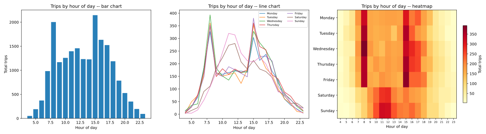

# VISTA · Travel Data Analysis

[](https://github.com/yiqunqiao/vista-travel-analysis/actions/workflows/ci.yml)


**Explore how feature representation, sample size and distribution shift affect travel-data models.**

Four reproducible experiments using the Victorian Integrated Survey of Travel and Activity (VISTA): mixed-distance KNN, work-from-home classification, exploratory charts and travel-time regression. Input data is bundled as compressed CSV files, so the scripts run outside the course platform.



## Reproduce all four tasks

```sh
python3 -m venv .venv
source .venv/bin/activate
pip install -r requirements.txt
python run.py
```

Use `.venv\Scripts\activate` on Windows. To run one experiment: `python run.py task2`. Each task writes its JSON metrics, charts and log to its own `outputs/taskN/` directory. The four-task reference run took about 31 seconds.

## Experiments and results

| Task | Question | Reference result |
| --- | --- | --- |
| 1 · KNN | Does a feature-specific distance help public-transport prediction? | Macro-F1 **0.7133** with mixed distance vs **0.6581** with one-hot Euclidean distance |
| 2 · Classification | How does occupation encoding affect work-from-home prediction? | One-hot Macro-F1: **0.6925** decision tree; **0.6687** logistic regression |
| 3 · Exploration | How do trips vary by hour, weekday, age and occupation? | Count tables, occupation-age charts and hourly travel charts |
| 4 · Regression | What changes with more training data and longer trips? | Two-feature model MSE **79.51** on the usual-distance test set vs **1762.19** on the long-distance set |

These values come from the saved 11 November 2026 execution, not illustrative examples. Both KNN configurations use `k=7` and the same 2,603 training / 858 test people. Household-level splits keep household members together.

## Data and outputs

| Bundled file | Rows | Use |
| --- | ---: | --- |
| `data/person_vista_2024_2025_clean.csv.gz` | 6,344 | Tasks 1–2; 17 required columns |
| `data/vista_task3_student_data.csv.gz` | 19,864 | Task 3; seven survey columns |
| `data/trips_vista_2024_2025.csv.gz` | 19,864 | Task 4; five required columns |

The course-provided VISTA files retain all rows; the person and trip files include only columns used by these experiments. Original survey identifiers are anonymous grouping keys. No synthetic records are substituted. The launcher restores the compressed CSVs from their bundled `.b64` files automatically; pandas reads the restored files directly. Set `VISTA_DATA_DIR` to use an alternative directory with the same compressed filenames.

The [results file](docs/results.json) contains reference JSON metrics and charts. [validation.json](validation.json) records all four completed runs and generated artefacts. Local outputs are excluded from version control.

## Code map

Each `taskN/` contains its data preparation, model or chart functions, and `main.py`. The root launcher supplies portable paths and separate output directories; model implementations and experiment definitions remain in the task modules.

## Project context

Prepared by Yiqun Qiao within the University of Melbourne COMP90049 framework using course-provided VISTA data. Original source attribution is retained. This portfolio version adds bundled inputs, portable paths, a shared launcher, saved results and continuous checks.

